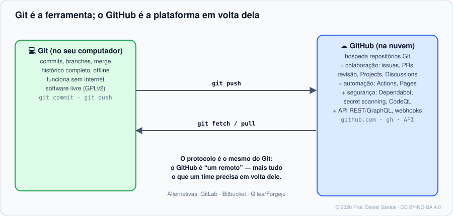

<div align="center">

# 🐙 GitHub: Colaboração, Automação e Segurança

### Curso 2 da jornada do desenvolvedor — aberto, prático e verificável

*Material didático gratuito e aberto — para uso não comercial.*

[](LICENSE)
[](LICENSE-CONTEUDO.md)
[](https://github.com/dsantos-docencia/github/actions)
[](CONTRIBUTING.md)

</div>

---

## 👋 Boas-vindas

Olá! Eu sou o **Professor Daniel Santos**: desenvolvedor, provedor de serviços de tecnologia e professor de cursos técnicos de TI e segurança cibernética.

No [curso de Git](https://github.com/dsantos-docencia/git) você aprendeu a **ferramenta**. Aqui você aprende a **plataforma** que o mercado usa em volta dela: como um time conversa por issues e pull requests, como o código é testado e publicado sozinho com o GitHub Actions, e como a cadeia de suprimentos é protegida, de tokens e dependências a ações de terceiros.

Como nos outros cursos da trilha, cada conceito vem com **o porquê**, cada exemplo **roda de verdade** (uma esteira automática executa tudo a cada alteração) e cada exercício tem **correção automática**. Para corrigir exercícios de GitHub **sem internet e sem token**, o curso traz um **`gh` simulado** que registra o que o seu script pede à plataforma. Quando quiser, os exemplos rodam no **GitHub de verdade**, contra um repositório de laboratório seu. Cada módulo termina com as **fontes oficiais** (docs.github.com em português e o manual do `gh`).

> *"O GitHub não é onde o código fica guardado. É onde o time trabalha."* — Prof. Daniel

---

## 🧭 A trilha da jornada do desenvolvedor

| Curso | Foco | Repositório |
|---|---|---|
| 1 · Git | a ferramenta: versionar, ramificar, colaborar, investigar | [dsantos-docencia/git](https://github.com/dsantos-docencia/git) |
| **2 · GitHub** ← você está aqui | pull requests, Actions, segurança, comunidade open source | [dsantos-docencia/github](https://github.com/dsantos-docencia/github) |
| 3 · GitLab | merge requests, CI/CD integrado, auto-hospedagem | [dsantos-docencia/gitlab](https://github.com/dsantos-docencia/gitlab) *(em construção)* |
| 4 · Bitbucket | integração com Jira, Pipelines, times Atlassian | [dsantos-docencia/bitbucket](https://github.com/dsantos-docencia/bitbucket) *(em construção)* |



---

## 🗺️ Trilha de aprendizado

Cada módulo tem: **teoria** com cenário, diagramas, tabelas de comandos com variações e fontes oficiais (`README.md`), **exemplos executáveis comentados** (`exemplos/`) e **exercícios com correção automática** (`exercicios/`).

| # | Módulo | O que você domina | Horas | Status |
|---|---|---|---|---|
| 00 | [Boas-vindas e fundamentos](modulos/00-boas-vindas-e-fundamentos/) | Git × GitHub, contas e planos, interface e atalhos, Markdown do GitHub, primeiros passos com o `gh` | 3–4 | ✅ |
| 01 | [Conta, segurança e autenticação](modulos/01-conta-seguranca-e-autenticacao/) | 2FA e passkeys, e-mail noreply, HTTPS × SSH × `gh auth`, tokens fine-grained, commits verificados | 4–5 | ✅ |
| 02 | [Repositórios](modulos/02-repositorios/) | criar e publicar, visibilidade, licença, configurações, papéis de acesso, ciclo de vida | 4–5 | ✅ |
| 03 | [Issues, labels e Projects](modulos/03-issues-labels-e-projects/) | bons relatos, issue forms, labels, busca avançada, fechar por PR, Projects | 4–5 | ✅ |
| 04 | [Pull requests e code review](modulos/04-pull-requests-e-code-review/) | PRs revisáveis, revisão com sugestões, CODEOWNERS, template de PR, métodos de merge | 5–6 | ✅ |
| 05 | [Forks e open source](modulos/05-forks-e-open-source/) | fork × branch, contribuir e sincronizar, arquivos de saúde da comunidade, etiqueta | 4–5 | ✅ |
| 06 | Proteção de branches e rulesets | rulesets, aprovações e checks obrigatórios, merge queue, modo *evaluate* | 4–5 | 🚧 |
| 07 | GitHub Actions: fundamentos | eventos, jobs, steps, runners, contextos, expressões, saídas e resumos | 5–6 | 🚧 |
| 08 | GitHub Actions: avançado | matriz, cache, artefatos, ambientes, workflows reutilizáveis, ações compostas, OIDC | 5–6 | 🚧 |
| 09 | Releases, Packages e Pages | releases com notas automáticas e checksums, GHCR, site no Pages | 4–5 | 🚧 |
| 10 | Segurança da cadeia de suprimentos | Dependabot, secret scanning, CodeQL, ações fixadas por SHA, lockfiles, injeção em workflows | 5–6 | 🚧 |
| 11 | Automação com gh e API | REST e GraphQL, paginação, webhooks com assinatura, extensões do `gh` | 4–5 | 🚧 |

---

## 🚦 Começando em 3 passos

```bash
# 1. Clone o repositório
git clone https://github.com/dsantos-docencia/github.git curso-github
cd curso-github

# 2. Rode um exemplo (simulado: sem internet, sem conta, nada é criado)
bash modulos/00-boas-vindas-e-fundamentos/exemplos/01-primeiros-comandos-gh.sh

# 3. Faça um exercício e corrija na hora
./ferramentas/corrigir.sh 02        # todos os exercícios do módulo 02
./ferramentas/corrigir.sh 02 03     # só o exercício 03
```

Quer ver no GitHub de verdade? Crie seu repositório de laboratório ([laboratorio/](laboratorio/)) e rode os exemplos marcados com `GH_REAL=1`:

```bash
GH_REAL=1 LAB_REPO=seu-usuario/lab-github bash modulos/03-issues-labels-e-projects/exemplos/02-busca-avancada.sh
```

Requisitos: Bash, Git, `jq` e `python3` com PyYAML (no Windows, use o **Git Bash** ou o WSL). Ambiente idêntico ao do professor: `./laboratorio/entrar.sh` (Docker).

---

## 🧰 O que torna este repositório diferente

- **Tudo roda.** O [GitHub Actions](.github/workflows/verificar.yml) executa ShellCheck, valida todo YAML, passa os workflows pelo **actionlint** e pelo **zizmor**, roda **todos** os exemplos e confere as soluções contra os testes a cada push.
- **Um `gh` simulado para aprender sem medo.** [`ferramentas/simulador/gh`](ferramentas/simulador/gh) registra cada chamada e responde com dados de um repositório fictício. O corretor confere *o que* você pediu ao GitHub (`gh issue create --label bug …`) sem tocar na sua conta.
- **Configuração tratada como código.** Issue forms, CODEOWNERS, rulesets, workflows e `dependabot.yml` são lidos como dados e verificados campo a campo.
- **O repositório pratica o que ensina.** O workflow de CI fixa ações por SHA, declara permissões mínimas e não persiste credenciais, e é auditado pelo zizmor.
- **Fonte oficial em cada módulo** e **diagramas originais** em [assets/](assets/), licenciados junto com o conteúdo.

---

## 🤝 Contribuindo

> **Junte-se a mim e deixe algo de útil para o próximo.** 🌱 Conhecimento que não é compartilhado morre com quem o guarda.

- **Achou um erro ou tem uma ideia?** [Abra uma issue](https://github.com/dsantos-docencia/github/issues/new/choose) ou mande um PR. Contribuir com este curso é o exercício final do Módulo 05. 😉
- **Tem um script ou workflow útil?** Envie pela trilha **“📜 Enviar um script para a comunidade”**. Os aprovados entram em [`scripts/comunidade/`](scripts/comunidade/) com o seu crédito.
- **Fala outro idioma?** Ajude a traduzir ([guia](traducoes/README.md)). A versão em inglês está nos planos.

Leia o [guia de contribuição](CONTRIBUTING.md). Quem contribui entra em [CONTRIBUTORS.md](CONTRIBUTORS.md). 💚

---

## 📜 Licença e direitos

- **Código** (scripts, ferramentas, exemplos, workflows): [PolyForm Noncommercial 1.0.0](LICENSE).
- **Conteúdo didático** (textos, exercícios, diagramas): [CC BY-NC-SA 4.0](LICENSE-CONTEUDO.md).
- **Uso comercial não é permitido** sem autorização do autor. Veja o [NOTICE](NOTICE.md).
- GitHub® e o logotipo do Octocat são marcas da GitHub, Inc. Este é um curso independente, sem vínculo com a empresa. A documentação oficial é **citada e apontada**, não reproduzida.

© 2026 **Daniel Santos (Prof. Daniel Santos)**. Todos os direitos reservados ao autor; as licenças acima são concedidas ao público.
