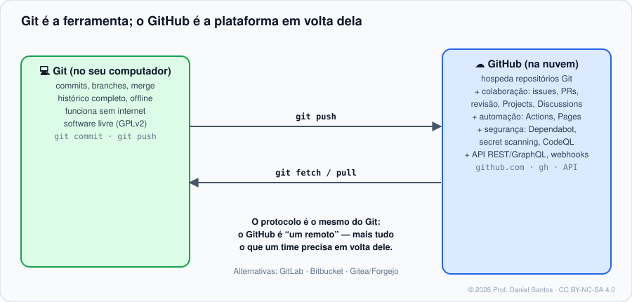
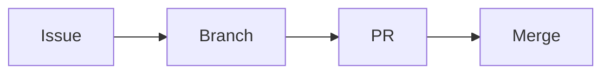

# Módulo 00 · Boas-vindas e fundamentos

> **Você vai sair daqui sabendo:** a diferença entre Git e GitHub (e por que ela importa), os tipos de conta e plano, como andar pela interface com atalhos, escrever Markdown no padrão do GitHub e dar os primeiros passos com o `gh`, a CLI oficial — além de como este curso funciona sem exigir internet para corrigir os exercícios.

⏱ 3–4 h · 🧪 [Laboratório](../../laboratorio/) · ✍️ [Exercícios](exercicios/)

---

## 1. Cenário

Você já sabe Git ([curso 1 da trilha](https://github.com/dsantos-docencia/git)): versiona, ramifica, resolve conflito. Agora entra num time de verdade. Alguém diz “abre um PR”, “o CI quebrou”, “marca o CODEOWNER”, “o Dependabot abriu um alerta”. Nada disso é Git — é **GitHub**, a plataforma que o mercado usa em volta do Git. Este curso ensina essa camada: colaboração, automação e segurança.

## 2. Git × GitHub



| | Git | GitHub |
|---|---|---|
| O que é | programa que versiona arquivos | serviço web que hospeda repositórios Git |
| Onde roda | no seu computador | na nuvem (github.com) ou no servidor da empresa (GitHub Enterprise Server) |
| Precisa de internet? | não | sim |
| Dono | projeto livre (GPLv2) | Microsoft (desde 2018) |
| Concorrentes | — (Mercurial, SVN, hoje raros) | GitLab, Bitbucket, Gitea/Forgejo, Azure Repos |

> 🧠 **Por que isso importa:** quando algo dá errado, saber *em que camada* está o problema economiza horas. “Push recusado por regra” é GitHub (ruleset); “conflito” é Git; “a ação falhou” é GitHub Actions.

## 3. Contas e planos

- **Conta pessoal** — você. Um nome de usuário (`@voce`), único na plataforma. Mudar o nome é possível, mas quebra links antigos de perfil.
- **Organização** — um “guarda-chuva” para repositórios de um time ou empresa, com **times** e permissões. Você entra com a sua conta pessoal; ninguém “loga como a organização”.
- **Enterprise** — várias organizações sob uma gestão central (SSO, auditoria, políticas).

| Plano | Para quem | Destaques |
|---|---|---|
| **Free** | pessoas e organizações | repositórios públicos e privados ilimitados; Actions ilimitado em repositórios públicos e 2.000 min/mês nos privados |
| **Pro** | pessoa | mais minutos (3.000) e recursos avançados também em repositórios privados |
| **Team** | organizações | proteções e revisores obrigatórios em privados, mais minutos |
| **Enterprise** | empresas | SSO, auditoria, políticas, GitHub Advanced Security |

> ⚠️ Recursos e cotas mudam com frequência. Antes de decidir algo que custa dinheiro, confira a [página oficial de planos](https://docs.github.com/pt/get-started/learning-about-github/githubs-plans). Estudante? O [GitHub Education](https://education.github.com) libera benefícios gratuitos.

## 4. Andando pela interface

Num repositório, as abas contam a história do projeto:

| Aba | Para quê |
|---|---|
| **Code** | arquivos, branches, tags, README renderizado |
| **Issues** | tarefas, bugs, ideias (Módulo 03) |
| **Pull requests** | propostas de mudança com revisão (Módulo 04) |
| **Actions** | automações e CI/CD (Módulos 07–08) |
| **Projects** | quadros e planilhas de planejamento (Módulo 03) |
| **Security** | alertas de dependências, segredos e código (Módulo 10) |
| **Insights** | gráficos de contribuição, tráfego, rede de forks |
| **Settings** | configurações (só quem tem papel de admin vê) |

### Atalhos que economizam o dia

| Tecla | O que faz |
|---|---|
| `?` | mostra todos os atalhos da página |
| `t` | busca de arquivo por nome (*file finder*) |
| `.` | abre o repositório no **github.dev** (VS Code no navegador) |
| `y` | troca a URL do arquivo por um **permalink** (fixado no commit) — use para citar código |
| `/` ou `s` | foca a busca |
| `g` `i` / `g` `p` | vai para Issues / Pull requests |

> 💡 **Permalink é cidadania.** Um link para `blob/main/app.js#L10` aponta para *outra* linha amanhã. Com `y`, o link fica preso ao commit e continua certo para sempre.

## 5. Markdown no padrão do GitHub (GFM)

Tudo no GitHub — README, issue, PR, comentário, wiki — é escrito em **GitHub Flavored Markdown**:

````markdown
# Título            ## Seção          **negrito**  _itálico_  `código`

> [!NOTE]
> Alertas: NOTE, TIP, IMPORTANT, WARNING, CAUTION — viram caixas coloridas.

- [x] tarefa concluída        ← listas de tarefas (checkbox clicável em issues)
- [ ] tarefa pendente

| Coluna | Outra |
|---|:---:|
| texto | centralizado |

```bash
echo "bloco com destaque de sintaxe"
```



Menções: @usuario  @org/time   Referências: #42  org/repo#42  um SHA (a1b2c3d)
Nota de rodapé[^1]

[^1]: aparece no fim da página.
````

- **Diagramas** em blocos ` ```mermaid ` são desenhados pelo próprio GitHub.
- **`#42`** vira link para o issue/PR 42; **`@nome`** notifica a pessoa — use com intenção.
- Arraste uma imagem para a caixa de texto e o GitHub hospeda e gera o link.

## 6. O `gh`: o GitHub no terminal

O [GitHub CLI](https://cli.github.com) (`gh`) é a ferramenta oficial para fazer pelo terminal o que se faz no site: criar repositório, abrir PR, ver o CI, chamar a API.

```bash
# instalar
winget install --id GitHub.cli        # Windows
brew install gh                       # macOS
sudo apt install gh                   # Debian/Ubuntu (repositório oficial: veja laboratorio/)

gh --version
gh auth login                         # login pelo navegador (Módulo 01)
gh repo view cli/cli                  # README de um repositório
gh issue list -R cli/cli --limit 5    # 5 issues de outro repositório
gh browse                             # abre o repositório atual no navegador
gh help pr create                     # ajuda de qualquer comando
```

| Comando | Variações úteis |
|---|---|
| `gh repo view [dono/repo]` | `--web` · `--json name,description` · `--jq .description` |
| `gh <coisa> list` | `-R dono/repo` · `--limit 50` · `--json campos` · `--jq filtro` |
| `gh config set CHAVE VALOR` | `git_protocol ssh` · `editor "code --wait"` · `prompt disabled` |
| `gh alias set NOME 'comando'` | `gh alias set prs 'pr list --author @me'` · `gh alias list` |

> 🧠 **`--json` + `--jq` é o superpoder do `gh`:** toda listagem vira dado estruturado. `gh pr list --json number,title --jq '.[].title'` — sem “raspar” texto da tela. O `--jq` usa a mesma linguagem do [`jq`](https://jqlang.org).

## 7. Como este curso funciona (e por que tem um `gh` de mentira)

Os exercícios de Git do curso anterior eram corrigidos montando repositórios de verdade. Mas o GitHub está na internet: se cada exercício criasse issues na sua conta, o corretor dependeria de rede, de token e do estado da sua conta.

A solução foi um **simulador**: [`ferramentas/simulador/gh`](../../ferramentas/simulador/gh). Ele fica na frente do `gh` verdadeiro, **registra cada chamada** que seu script faz e responde com dados de exemplo (o repositório fictício `aluno/laboratorio`). O corretor então confere *o que* você pediu ao GitHub — `gh issue create --title … --label bug` — sem nada sair da sua máquina.

- **Exemplos** rodam simulados por padrão. Muitos aceitam `GH_REAL=1 LAB_REPO=voce/lab-github` para rodar no GitHub de verdade, contra o repositório de laboratório que você cria no [laboratório](../../laboratorio/).
- **Exercícios** rodam sempre simulados — correção previsível, igual para todo mundo.
- **Configurações** (workflows, issue forms, rulesets) são validadas como dado: o corretor lê o YAML/JSON e confere a estrutura; workflows passam também pelo [actionlint](https://github.com/rhysd/actionlint).

## 8. Armadilhas comuns

- **Confundir e-mail do Git com conta do GitHub.** O GitHub liga um commit à sua conta pelo **e-mail** do commit. E-mail errado = commits “sem dono” no seu perfil (Módulo 01).
- **Repositório público por engano.** Público é público para o mundo e para robôs que caçam senhas. Na dúvida, crie privado e abra depois.
- **Linkar `blob/main`** em documentação permanente — use permalink (`y`).
- **Notificações demais.** Ajuste em *Settings → Notifications* e use **Watch → Custom** nos repositórios.

## 📚 Fontes oficiais

- Sobre o GitHub e o Git: <https://docs.github.com/pt/get-started/start-your-journey/about-github-and-git>
- Planos do GitHub: <https://docs.github.com/pt/get-started/learning-about-github/githubs-plans>
- Tipos de conta: <https://docs.github.com/pt/get-started/learning-about-github/types-of-github-accounts>
- Atalhos de teclado: <https://docs.github.com/pt/get-started/accessibility/keyboard-shortcuts>
- Escrita e formatação (GFM): <https://docs.github.com/pt/get-started/writing-on-github>
- Manual do GitHub CLI: <https://cli.github.com/manual/>
- Cursos interativos oficiais (GitHub Skills): <https://skills.github.com>

---

<sub>© 2026 Prof. Daniel Santos · Curso de GitHub · conteúdo sob CC BY-NC-SA 4.0 · <a href="../../NOTICE.md">aviso de direitos</a></sub>
