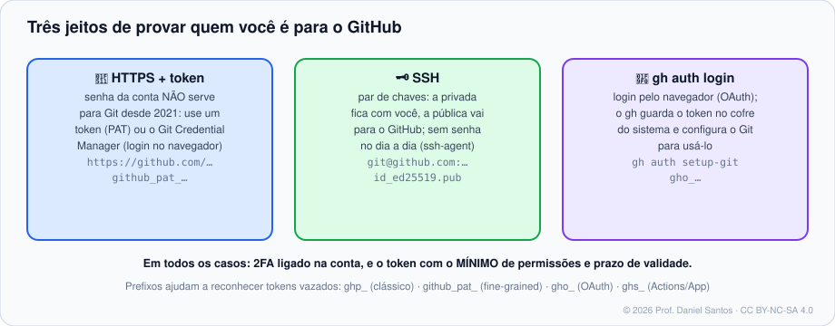

# Módulo 01 · Conta, segurança e autenticação

> **Você vai sair daqui sabendo:** proteger a conta com 2FA e passkeys, manter seu e-mail privado sem perder a autoria dos commits, escolher entre HTTPS, SSH e `gh auth`, criar tokens com o mínimo de permissão, reconhecer um token vazado pelo prefixo e assinar commits para ganhar o selo **Verified**.

⏱ 4–5 h · 🧪 [Laboratório — criar a conta](../../laboratorio/#opção-a--github-de-verdade-recomendado) · ✍️ [Exercícios](exercicios/)

---

## 1. Cenário

Sua conta do GitHub vai guardar código de clientes, chaves de deploy, acesso a organizações. Contas sem 2FA são o alvo número 1 de ataques à cadeia de suprimentos: quem rouba a senha de um mantenedor publica uma versão maliciosa de um pacote usado por milhões. Por isso o GitHub **exige 2FA** de quem contribui com código na plataforma — e por isso começamos pela segurança, antes de criar qualquer repositório.

## 2. A conta bem configurada

| Item | Onde | Por quê |
|---|---|---|
| **2FA** (app autenticador, passkey ou chave física) | *Settings → Password and authentication* | senha vazada deixa de ser suficiente |
| **Códigos de recuperação** guardados offline | mesma página | perder o celular sem eles pode significar perder a conta |
| **Passkey** | mesma página | login sem senha, resistente a phishing |
| **E-mail privado** + *Block command line pushes that expose my email* | *Settings → Emails* | seu e-mail real não fica público em cada commit |
| **Revisar sessões e o security log** | *Settings → Sessions / Security log* | descobrir acesso que você não fez |

### O e-mail do commit e o `noreply`

O GitHub liga um commit à sua conta pelo **e-mail** gravado nele (Módulo 01 do curso de Git). Para não expor seu e-mail pessoal, use o endereço que o GitHub cria para você:

```
ID+usuario@users.noreply.github.com      ← ID numérico da conta + seu usuário
```

```bash
gh api user --jq '"\(.id)+\(.login)@users.noreply.github.com"'   # descobre o seu
git config --global user.email "1234567+voce@users.noreply.github.com"
```

> 🧠 **Por que o ID?** Usuários podem mudar de nome; o ID numérico, não. O formato com ID garante que commits antigos continuem ligados a você depois de uma troca de nome.

## 3. Três jeitos de autenticar o Git



Desde 2021 a **senha da conta não funciona** para operações Git. Você escolhe:

| | HTTPS + token / Credential Manager | SSH | `gh auth login` |
|---|---|---|---|
| URL do remoto | `https://github.com/dono/repo.git` | `git@github.com:dono/repo.git` | qualquer uma |
| Credencial | token (PAT) ou login no navegador via GCM | par de chaves (`id_ed25519`) | token OAuth guardado no cofre do sistema |
| Firewall corporativo | passa (porta 443) | porta 22 às vezes bloqueada — use `ssh.github.com:443` | passa |
| Melhor para | Windows com GCM; começar rápido | quem usa vários serviços e quer zero prompt | quem já usa o `gh` |

### SSH passo a passo

```bash
ssh-keygen -t ed25519 -C "voce@exemplo.com"          # cria ~/.ssh/id_ed25519 (+ .pub); use frase-senha
eval "$(ssh-agent -s)" && ssh-add ~/.ssh/id_ed25519  # guarda a chave destrancada na sessão
gh ssh-key add ~/.ssh/id_ed25519.pub --title "notebook" --type authentication
ssh -T git@github.com                                # "Hi voce! You've successfully authenticated…"
```

Um `~/.ssh/config` deixa tudo explícito (e resolve a porta 22 bloqueada):

```sshconfig
Host github.com
    HostName github.com
    User git
    IdentityFile ~/.ssh/id_ed25519
    IdentitiesOnly yes          # oferece SÓ esta chave (evita "Too many authentication failures")
    AddKeysToAgent yes

Host github-443                 # alternativa: git@github-443:dono/repo.git
    HostName ssh.github.com
    Port 443
    User git
```

> 🔎 **Confie, mas confira:** na primeira conexão, compare a impressão digital mostrada com as [publicadas pelo GitHub](https://docs.github.com/pt/authentication/keeping-your-account-and-data-secure/githubs-ssh-key-fingerprints).

### `gh auth`

```bash
gh auth login                    # escolha GitHub.com → HTTPS ou SSH → login pelo navegador
gh auth status                   # quem está logado, com quais escopos
gh auth setup-git                # faz o Git usar o gh como "credential helper"
gh auth refresh -s delete_repo   # pede um escopo a mais só quando precisar
gh auth token                    # imprime o token (cuidado onde você cola isso!)
```

## 4. Tokens: o mínimo, pelo menor tempo

| | **Fine-grained** (`github_pat_…`) | **Clássico** (`ghp_…`) |
|---|---|---|
| Alcance | repositórios **escolhidos** | todos os repositórios a que você tem acesso |
| Permissões | por recurso (Contents: read, Issues: write…) | escopos largos (`repo` = tudo) |
| Validade | obrigatória (máx. configurável pela org) | pode ser “sem validade” 😬 |
| Aprovação da org | pode exigir | não |
| Quando usar | **sempre que der** | só onde o fine-grained ainda não chega |

**Reconhecendo tokens pelo prefixo** — útil para achar vazamentos em logs e commits:

| Prefixo | Tipo |
|---|---|
| `ghp_` | token pessoal clássico |
| `github_pat_` | token pessoal fine-grained |
| `gho_` | token OAuth (ex.: o que o `gh auth login` cria) |
| `ghu_` | token usuário-para-servidor de GitHub App |
| `ghs_` | token servidor-para-servidor (GitHub App, e o `GITHUB_TOKEN` do Actions) |
| `ghr_` | *refresh token* de GitHub App |

> 🚨 **Vazou um token?** Revogue **primeiro** (*Settings → Developer settings*), investigue depois. Apagar o commit não adianta: robôs leem o GitHub público em segundos. O *secret scanning* (Módulo 10) avisa o GitHub e, em muitos casos, o próprio emissor revoga o token.

## 5. Commits verificados

Qualquer um pode criar um commit dizendo ser você (`git config user.email` aceita qualquer coisa). A **assinatura** prova a autoria — e o GitHub mostra o selo **Verified**.

```bash
gh ssh-key add ~/.ssh/id_ed25519.pub --type signing --title "assinatura"
git config --global gpg.format ssh
git config --global user.signingkey ~/.ssh/id_ed25519.pub
git config --global commit.gpgsign true
```

Ligue o **vigilant mode** (*Settings → SSH and GPG keys*) para que commits **não assinados** em seu nome apareçam como *Unverified* — assim um impostor fica visível.

## 6. Armadilhas comuns

- **Token no histórico, no `.env` versionado ou no print do terminal** em issue pública.
- **Token clássico com escopo `repo` e sem validade** para “só rodar um script”.
- **`git remote` com o token na URL** (`https://TOKEN@github.com/...`): ele fica gravado em `.git/config` e aparece em `git remote -v`.
- **Chave SSH sem frase-senha** em notebook sem criptografia de disco.
- **Commits com `voce@empresa.local`** — não ligam a conta nenhuma.

## 📚 Fontes oficiais

- Autenticação de dois fatores: <https://docs.github.com/pt/authentication/securing-your-account-with-two-factor-authentication-2fa>
- Passkeys: <https://docs.github.com/pt/authentication/authenticating-with-a-passkey/about-passkeys>
- Configurar o e-mail de commit: <https://docs.github.com/pt/account-and-profile/setting-up-and-managing-your-personal-account-on-github/managing-email-preferences/setting-your-commit-email-address>
- Conectar com SSH: <https://docs.github.com/pt/authentication/connecting-to-github-with-ssh>
- SSH pela porta 443: <https://docs.github.com/pt/authentication/troubleshooting-ssh/using-ssh-over-the-https-port>
- Tokens de acesso pessoal: <https://docs.github.com/pt/authentication/keeping-your-account-and-data-secure/managing-your-personal-access-tokens>
- Formatos de token: <https://docs.github.com/pt/authentication/keeping-your-account-and-data-secure/about-authentication-to-github#githubs-token-formats>
- Verificação de assinatura de commits: <https://docs.github.com/pt/authentication/managing-commit-signature-verification>
- `gh auth`: <https://cli.github.com/manual/gh_auth>

---

<sub>© 2026 Prof. Daniel Santos · Curso de GitHub · conteúdo sob CC BY-NC-SA 4.0 · <a href="../../NOTICE.md">aviso de direitos</a></sub>
