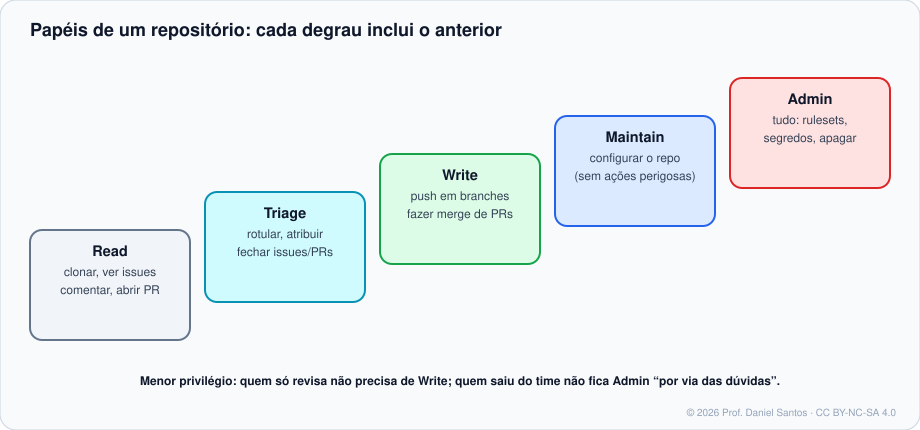

# Módulo 02 · Repositórios

> **Você vai sair daqui sabendo:** criar e publicar repositórios pelo site e pelo `gh`, escolher visibilidade e licença, configurar o que o repositório aceita (métodos de merge, apagar branch após o merge, recursos ligados), usar templates, dar acesso às pessoas com o papel certo — e renomear, transferir, arquivar e apagar sem quebrar nada.

⏱ 4–5 h · 🧪 [Laboratório](../../laboratorio/) · ✍️ [Exercícios](exercicios/)

---

## 1. Cenário

A loja do bairro vai ganhar um site. Você precisa publicar o código, decidir quem vê (todo mundo? só o time?), deixar claro sob que licença outros podem usar, convidar a Bia para programar e o Caio para testar — sem dar a nenhum dos dois o poder de apagar o repositório.

## 2. Criando

| Jeito | Quando |
|---|---|
| Botão **New** (ou <https://github.com/new>) | primeira vez, explorando as opções |
| `gh repo create` | sempre depois disso — rápido, repetível, scriptável |
| **Use this template** | começar de um modelo pronto (estrutura, CI, templates de issue) |
| **Import repository** | trazer de outro serviço (inclusive SVN/Mercurial) |

```bash
# do zero, já clonando
gh repo create loja-site --private --clone --add-readme --license mit --gitignore Node

# publicar uma pasta que já é repositório Git (o caso mais comum!)
cd loja-site && gh repo create --private --source . --remote origin --push

# a partir de um template
gh repo create loja-api --template dsantos-docencia/modelo-api --private --clone
```

| Opção | Efeito |
|---|---|
| `--public` / `--private` / `--internal` | visibilidade (`internal`: só membros da empresa, em Enterprise) |
| `--source . --push` | usa a pasta atual e envia os commits |
| `--description "…"` · `--homepage URL` | metadados mostrados na página |
| `--add-readme` · `--license mit` · `--gitignore Python` | arquivos iniciais |
| `--template dono/repo` | copia o conteúdo (sem o histórico) de um template |
| `--disable-issues` · `--disable-wiki` | desliga recursos |

### Público ou privado?

- **Público**: qualquer pessoa vê e clona; robôs também. Ótimo para portfólio, open source, material didático. Recursos de segurança como secret scanning ficam **gratuitos**.
- **Privado**: só quem você convidar. Comece privado quando houver qualquer dúvida — tornar público depois é um clique; “despublicar” não apaga clones que já foram feitos.

### Licença: sem licença ≠ livre

Código público **sem arquivo de licença** continua com **todos os direitos reservados**: ninguém pode legalmente usar, copiar ou modificar. Escolha consciente ([choosealicense.com](https://choosealicense.com/)):

| Licença | Em uma frase |
|---|---|
| MIT | faça o que quiser, mantenha o aviso de copyright |
| Apache-2.0 | como a MIT, com concessão explícita de patentes |
| GPL-3.0 | quem distribuir versões modificadas precisa abrir o código também |
| CC BY-NC-SA 4.0 | (para **conteúdo**) uso não comercial, com atribuição e mesma licença — a deste curso |

## 3. Configurações que importam (Settings → General)

| Configuração | Recomendação | Por quê |
|---|---|---|
| **Default branch** | `main` | padrão atual do Git e do GitHub |
| **Pull Requests → métodos de merge** | escolha 1 ou 2 (ex.: squash + rebase) | histórico consistente; Módulo 04 |
| **Automatically delete head branches** | ✅ | branch mesclada some sozinha — sem cemitério de branches |
| **Always suggest updating PR branches** | ✅ | lembra de atualizar com a `main` antes do merge |
| **Features** (Issues, Wiki, Discussions, Projects) | só o que for usado | menos lugares para informação se perder |
| **Releases → immutable releases** | ✅ em projetos publicados | ninguém troca o binário de uma versão já publicada (Módulo 09) |

Tudo isso também pelo terminal:

```bash
gh repo edit --description "Site da Loja do Bairro" --homepage https://loja.exemplo.dev \
  --add-topic site --add-topic loja \
  --enable-merge-commit=false --enable-squash-merge --enable-rebase-merge \
  --delete-branch-on-merge --enable-wiki=false
```

## 4. Pessoas e papéis



```bash
gh api -X PUT repos/aluno/loja-site/collaborators/bia-dev -f permission=push     # Write
gh api -X PUT repos/aluno/loja-site/collaborators/caio-qa -f permission=triage   # Triage
gh api repos/aluno/loja-site/collaborators --jq '.[] | "\(.login)\t\(.role_name)"'
```

> 🧠 Na API, os nomes antigos convivem com os da tela: `pull` = Read, `push` = Write. Em **organizações**, prefira dar acesso a **times** (`@org/frontend`) em vez de pessoas: quando alguém sai do time, sai de todos os repositórios de uma vez.

## 5. Ciclo de vida

| Ação | Comando | O que acontece |
|---|---|---|
| Renomear | `gh repo rename novo-nome` | o GitHub **redireciona** a URL antiga (até alguém criar um repo com o nome antigo) |
| Transferir | Settings → *Transfer ownership* | issues, PRs, stars vão junto; redirecionamento também |
| Arquivar | `gh repo archive dono/repo` | fica **somente leitura**: sinal claro de “não mantido” |
| Apagar | `gh repo delete dono/repo` (exige `gh auth refresh -s delete_repo`) | **irreversível** na prática (há 90 dias de restauração só em alguns casos) — prefira arquivar |

## 6. Limites que você vai encontrar

- Arquivo acima de **50 MB** gera aviso; acima de **100 MB** o push é **recusado**. Arquivos grandes → **Git LFS** (curso de Git, Módulo 09) ou Releases.
- Repositórios devem ficar idealmente abaixo de 1 GB (forte recomendação: abaixo de 5 GB).
- Esses números mudam — confira a página de limites antes de projetar algo grande.

## 7. Armadilhas comuns

- `gh repo create` dentro de uma pasta **sem commits** e com `--push` → nada para enviar. Faça o primeiro commit antes.
- Template ≠ fork: template copia o conteúdo **sem histórico** e sem ligação; fork mantém o vínculo (Módulo 05).
- Tornar público um repositório que **já teve** um segredo commitado: o histórico vai junto. Limpe o histórico **e revogue** o segredo antes.
- Dar **Admin** a quem só precisava de Write “para não dar problema”.

## 📚 Fontes oficiais

- Início rápido para repositórios: <https://docs.github.com/pt/repositories/creating-and-managing-repositories/quickstart-for-repositories>
- Visibilidade: <https://docs.github.com/pt/repositories/creating-and-managing-repositories/about-repositories#about-repository-visibility>
- Licenciar um repositório: <https://docs.github.com/pt/repositories/managing-your-repositorys-settings-and-features/customizing-your-repository/licensing-a-repository>
- Templates de repositório: <https://docs.github.com/pt/repositories/creating-and-managing-repositories/creating-a-template-repository>
- Papéis de repositório em organizações: <https://docs.github.com/pt/organizations/managing-user-access-to-your-organizations-repositories/managing-repository-roles/repository-roles-for-an-organization>
- Arquivos grandes: <https://docs.github.com/pt/repositories/working-with-files/managing-large-files/about-large-files-on-github>
- `gh repo`: <https://cli.github.com/manual/gh_repo>

---

<sub>© 2026 Prof. Daniel Santos · Curso de GitHub · conteúdo sob CC BY-NC-SA 4.0 · <a href="../../NOTICE.md">aviso de direitos</a></sub>
