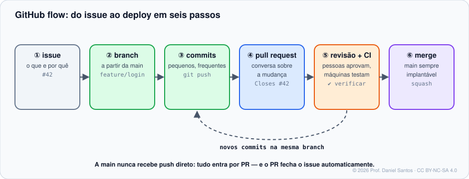

# Módulo 04 · Pull requests e code review

> **Você vai sair daqui sabendo:** abrir PRs que são fáceis de revisar, revisar o código de outra pessoa com critério e gentileza, sugerir mudanças aplicáveis com um clique, definir **CODEOWNERS** e **templates de PR**, escolher o método de merge certo e conduzir tudo isso também pelo `gh`.

⏱ 5–6 h · 🧪 [Laboratório](../../laboratorio/) · ✍️ [Exercícios](exercicios/)

---

## 1. Cenário

A Bia terminou o login por e-mail numa branch. Ela poderia fazer `git merge` na `main` e dar `push`… e é exatamente isso que um time maduro **não** faz. Um **pull request** (PR) é um pedido: *“puxe as mudanças da minha branch para a `main`”*. Em volta dele acontecem a revisão por outra pessoa, os testes automáticos e a conversa sobre o porquê da mudança — tudo registrado para sempre.



## 2. Anatomia de um PR

| Aba | O que mostra |
|---|---|
| **Conversation** | descrição, comentários, revisões, eventos (push, label, merge) |
| **Commits** | os commits da branch que ainda não estão na base |
| **Checks** | resultado do CI (Actions) — Módulo 07 |
| **Files changed** | o diff, onde a revisão linha a linha acontece |

- **Base** ← **compare**: a seta vai da sua branch para a branch que vai recebê-la.
- **Draft**: “ainda não está pronto, mas já quero feedback” — não pode ser mesclado, não notifica revisores.
- O PR **acompanha a branch**: novos commits na branch entram no PR automaticamente.

## 3. Um PR fácil de revisar

| Faça | Evite |
|---|---|
| uma mudança por PR (~200–400 linhas) | “PR de 3.000 linhas que mexe em tudo” |
| título no padrão do time (`feat: login por e-mail`) | “ajustes” |
| descrição com **o quê, por quê e como testar** | descrição vazia |
| `Closes #12` para ligar o issue | deixar o issue órfão |
| prints/gifs para mudanças visuais | “abre aí e vê” |
| revisar o próprio diff antes de pedir revisão | pedir revisão com `console.log` esquecido |

## 4. Revisando

Na aba *Files changed*, cada linha aceita comentário. No fim, **Review changes**:

| Tipo | Quando |
|---|---|
| **Comment** | observações, sem decisão |
| **Approve** | pode mesclar |
| **Request changes** | precisa mudar antes — bloqueia o merge se a branch exigir aprovação |

**Sugestões aplicáveis** — o autor aplica com um clique e vira commit:

````markdown
```suggestion
if (!email.includes("@")) return erro("e-mail inválido");
```
````

> 🧠 **Revise o código, não a pessoa.** Pergunte (“o que acontece se o e-mail vier vazio?”) em vez de afirmar (“isso está errado”). Marque o que é opinião (`nit:` = detalhe, não bloqueia). Elogie o que está bom — revisão também ensina.

## 5. CODEOWNERS: o revisor certo, automaticamente

`.github/CODEOWNERS` (ou na raiz, ou em `docs/`) diz quem é dono de cada parte do código. Os donos são **pedidos como revisores automaticamente** — e, com a regra “exigir revisão de code owner” (Módulo 06), sem a aprovação deles não há merge.

```gitignore
# A ÚLTIMA regra que casar vence — por isso o padrão geral vem PRIMEIRO.
*                 @aluno
*.js              @bia-dev
/docs/            @org/documentacao
/.github/         @aluno
```

| Padrão | Casa com |
|---|---|
| `*` | tudo |
| `*.js` | qualquer `.js`, em qualquer pasta |
| `/docs/` | a pasta `docs` da raiz e tudo dentro |
| `docs/` | qualquer pasta chamada `docs`, em qualquer nível |
| `/src/app.js` | só esse arquivo |

O dono precisa ter acesso de **escrita** ao repositório, senão a regra é ignorada (o GitHub avisa na própria página do arquivo).

## 6. Template de PR

`.github/pull_request_template.md` preenche a descrição de todo PR novo. Vários modelos? Use `.github/PULL_REQUEST_TEMPLATE/nome.md` e escolha pela URL (`?template=nome.md`). Veja o [template deste repositório](../../.github/PULL_REQUEST_TEMPLATE.md).

## 7. Métodos de merge

| Método | Resultado na `main` | Bom para |
|---|---|---|
| **Create a merge commit** | todos os commits da branch + 1 commit de merge | preservar a história exata de cada branch |
| **Squash and merge** | **1 commit** com tudo | branches com commits “wip”; histórico limpo, 1 PR = 1 commit |
| **Rebase and merge** | os commits da branch, reaplicados um a um, sem merge | commits já bem feitos que valem individualmente |

Escolha 1–2 por repositório (Settings → General) e combine com o time. **Auto-merge** (`gh pr merge --auto`) mescla sozinho quando aprovações e checks ficarem verdes.

## 8. PRs pelo terminal

```bash
gh pr create --base main --title "feat: login por e-mail" --body-file descricao.md --draft
gh pr create --fill                        # título/corpo a partir dos commits
gh pr list --search "review-requested:@me" # o que esperam de você
gh pr checkout 7                           # baixa a branch do PR 7 (até de forks)
gh pr diff 7 --name-only
gh pr review 7 --approve --body "Testei localmente, tudo certo 👍"
gh pr review 7 --request-changes --body "Falta tratar e-mail vazio."
gh pr checks 7 --watch                     # acompanha o CI
gh pr ready 7                              # tira do rascunho
gh pr merge 7 --squash --delete-branch     # ou --merge / --rebase; --auto para esperar os checks
```

## 9. Armadilhas comuns

- **PR que mistura refatoração com funcionalidade** — ninguém consegue revisar direito. Separe.
- **Aprovar sem abrir o código** (“LGTM” no automático).
- **Ignorar o CI vermelho** “porque é só um teste instável” — conserte ou marque o teste, não normalize o vermelho.
- **CODEOWNERS com o `*` no final** — a última regra vence, então ele “apaga” todas as outras.
- **Branch velha** — atualize com a `main` (`gh pr update-branch` ou rebase) antes de mesclar.

## 📚 Fontes oficiais

- Sobre pull requests: <https://docs.github.com/pt/pull-requests/collaborating-with-pull-requests/proposing-changes-to-your-work-with-pull-requests/about-pull-requests>
- Revisando mudanças propostas: <https://docs.github.com/pt/pull-requests/collaborating-with-pull-requests/reviewing-changes-in-pull-requests/reviewing-proposed-changes-in-a-pull-request>
- Sugestões em revisões: <https://docs.github.com/pt/pull-requests/collaborating-with-pull-requests/reviewing-changes-in-pull-requests/commenting-on-a-pull-request#adding-line-comments-to-a-pull-request>
- Sobre code owners: <https://docs.github.com/pt/repositories/managing-your-repositorys-settings-and-features/customizing-your-repository/about-code-owners>
- Template de pull request: <https://docs.github.com/pt/communities/using-templates-to-encourage-useful-issues-and-pull-requests/creating-a-pull-request-template-for-your-repository>
- Métodos de merge: <https://docs.github.com/pt/pull-requests/collaborating-with-pull-requests/incorporating-changes-from-a-pull-request/about-pull-request-merges>
- Auto-merge: <https://docs.github.com/pt/pull-requests/collaborating-with-pull-requests/incorporating-changes-from-a-pull-request/automatically-merging-a-pull-request>
- `gh pr`: <https://cli.github.com/manual/gh_pr>

---

<sub>© 2026 Prof. Daniel Santos · Curso de GitHub · conteúdo sob CC BY-NC-SA 4.0 · <a href="../../NOTICE.md">aviso de direitos</a></sub>
