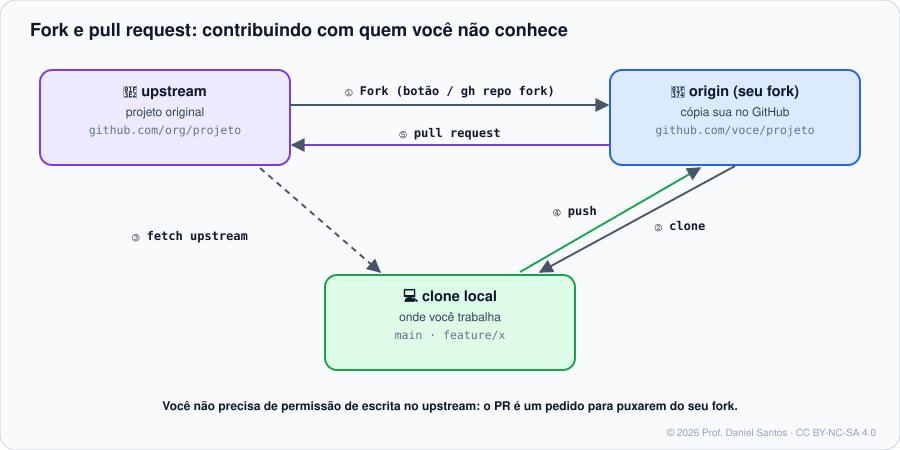

# Módulo 05 · Forks e open source

> **Você vai sair daqui sabendo:** quando usar fork e quando usar branch, contribuir com um projeto do qual você não é membro, manter seu fork em dia com o original, preparar o **seu** projeto para receber contribuições (arquivos de saúde da comunidade, licença, “good first issues”) e se comportar como um bom cidadão do open source.

⏱ 4–5 h · 🧪 [Laboratório](../../laboratorio/) · ✍️ [Exercícios](exercicios/)

---

## 1. Cenário

Você encontrou um erro de digitação na documentação de uma biblioteca que usa todo dia — ou quer adicionar uma funcionalidade a ela. Você **não tem permissão de escrita** no repositório dela (e nem deveria ter). O caminho é o **fork**: sua cópia pessoal no GitHub, de onde você abre um PR para o projeto original. É assim que milhões de pessoas contribuem com projetos de quem nunca conheceram — inclusive com este curso.

## 2. Fork × branch

| | Branch | Fork |
|---|---|---|
| Onde fica | dentro do mesmo repositório | um repositório novo, na sua conta |
| Precisa de escrita no original? | sim | **não** |
| Uso típico | time interno | contribuição externa, open source, experimentos |
| PR | branch → `main` | `voce:branch` → `org:main` |

## 3. O fluxo de contribuição



```bash
gh repo fork org/projeto --clone            # ① fork + ② clone; o gh já cria o remoto "upstream"
cd projeto
git remote -v                               # origin = seu fork · upstream = o original
git switch -c fix/erro-de-digitacao         # nunca trabalhe na main do fork
# ... edita, commita ...
git push -u origin fix/erro-de-digitacao    # ④ push para o SEU fork
gh pr create --repo org/projeto --fill      # ⑤ PR para o original
```

Antes de começar, **leia o `CONTRIBUTING.md`** do projeto: ele diz se precisa abrir issue antes, o padrão de commits, como rodar os testes. Muitos projetos marcam tarefas para iniciantes com **`good first issue`** e **`help wanted`**.

> ✅ Deixe marcado **“Allow edits by maintainers”** no PR: quem mantém o projeto pode corrigir um detalhe direto na sua branch em vez de pedir mais uma rodada.

### Mantendo o fork em dia

O original continua andando. Três jeitos de trazer as novidades (③ no diagrama):

```bash
# 1. Botão "Sync fork" na página do seu fork  (o mais simples)
# 2. gh — atualiza a main do fork no GitHub, sem baixar nada
gh repo sync voce/projeto --source org/projeto --branch main
# 3. Git puro — você controla cada passo
git fetch upstream
git switch main && git merge --ff-only upstream/main
git push origin main
```

> 🧠 **Por que `--ff-only`?** Se a `main` do seu fork só *segue* a do original (você nunca commita nela), a atualização é sempre um avanço rápido. Se o `--ff-only` falhar, é sinal de que alguém commitou na `main` do fork — exatamente o que você quer descobrir.

## 4. Preparando o SEU projeto para receber contribuições

O GitHub reconhece **arquivos de saúde da comunidade** na raiz, em `docs/` ou em `.github/`, e mostra uma checklist em **Insights → Community Standards** (`/community`):

| Arquivo | Para quê |
|---|---|
| `README.md` | o que é, como instalar, como usar |
| `LICENSE` | o que outros podem fazer com o código (sem ele: nada) |
| `CONTRIBUTING.md` | como contribuir: fluxo, padrões, como testar |
| `CODE_OF_CONDUCT.md` | como as pessoas devem se tratar e como denunciar abuso |
| `SECURITY.md` | como relatar vulnerabilidades **em privado** (Módulo 10) |
| `SUPPORT.md` | onde pedir ajuda (para não virar issue) |
| `.github/ISSUE_TEMPLATE/` e template de PR | relatos e PRs completos (Módulos 03 e 04) |
| `.github/FUNDING.yml` | botão “Sponsor” |

```bash
gh api repos/org/projeto/community/profile --jq '.health_percentage'   # nota de 0 a 100
```

> 💡 **Repositório `.github` da organização:** arquivos de saúde num repositório chamado `.github` valem como **padrão para todos** os repositórios da organização que não tiverem os seus.

### Licença pelo terminal

A API devolve o texto oficial das licenças, com campos para preencher:

```bash
gh api licenses/mit --jq .body | sed -e 's/\[year\]/2026/' -e 's/\[fullname\]/Ana Dev/' > LICENSE
```

## 5. Etiqueta de open source

- **Procure antes de abrir issue** — e, para mudanças grandes, **pergunte antes de programar**: o projeto pode não querer aquilo.
- PRs **pequenos e focados**. Um PR que corrige um bug não reformata o arquivo inteiro.
- Mantenedores são, quase sempre, voluntários. Paciência e cordialidade: “ping” educado depois de uma ou duas semanas.
- Projetos podem exigir **DCO** (`git commit -s`, uma declaração de que você pode contribuir aquele código) ou **CLA** (um contrato assinado uma vez).
- Primeiros PRs de contas novas podem precisar de **aprovação para rodar o CI** — proteção contra abuso do Actions.

## 6. Armadilhas comuns

- **Trabalhar na `main` do fork** — o PR seguinte arrasta commits antigos. Uma branch por contribuição.
- **Fork de repositório privado** herda a visibilidade e é apagado se você perder o acesso ao original.
- **Achar que o fork é backup**: quando o original apaga uma branch, ela continua no seu fork; mas quando o original fica privado ou some, a rede de forks pode ser reorganizada. Backup é outra coisa (`git clone --mirror`).
- **Segredos no fork**: commits que foram para o original continuam acessíveis pela rede de forks mesmo depois de “apagados”. Segredo vazado = segredo revogado.

## 📚 Fontes oficiais

- Sobre forks: <https://docs.github.com/pt/pull-requests/collaborating-with-pull-requests/working-with-forks/about-forks>
- Sincronizar um fork: <https://docs.github.com/pt/pull-requests/collaborating-with-pull-requests/working-with-forks/syncing-a-fork>
- Criar PR a partir de um fork: <https://docs.github.com/pt/pull-requests/collaborating-with-pull-requests/proposing-changes-to-your-work-with-pull-requests/creating-a-pull-request-from-a-fork>
- Arquivos de saúde da comunidade: <https://docs.github.com/pt/communities/setting-up-your-project-for-healthy-contributions/creating-a-default-community-health-file>
- Perfil da comunidade (API): <https://docs.github.com/pt/rest/metrics/community>
- Licenças (API): <https://docs.github.com/pt/rest/licenses/licenses>
- Guia open source (como contribuir): <https://opensource.guide/pt/how-to-contribute/>
- Escolha uma licença: <https://choosealicense.com>

---

<sub>© 2026 Prof. Daniel Santos · Curso de GitHub · conteúdo sob CC BY-NC-SA 4.0 · <a href="../../NOTICE.md">aviso de direitos</a></sub>
