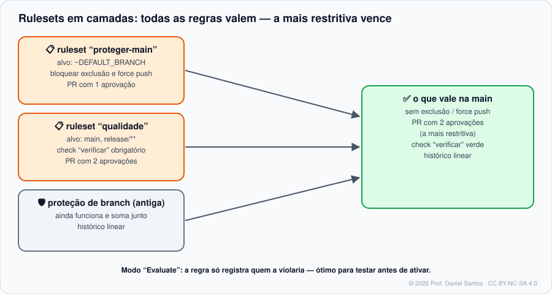

# Módulo 06 · Proteção de branches e rulesets

> **Você vai sair daqui sabendo:** por que a `main` precisa de regras, a diferença entre **proteção de branch** (modelo antigo) e **rulesets** (modelo atual), montar um ruleset completo — aprovações, checks obrigatórios, bloqueio de force push —, testá-lo em modo *evaluate* antes de ativar, aplicá-lo como código pela API e auditar o que vale de fato em cada branch.

⏱ 4–5 h · 🧪 [Laboratório](../../laboratorio/) · ✍️ [Exercícios](exercicios/)

---

## 1. Cenário

Sexta-feira, 18h. Alguém resolve “só um ajustezinho” direto na `main`, com `git push --force` porque o push foi recusado. O deploy automático leva o erro para produção e o force push apagou dois commits de um colega. Nada disso exige má-fé — só a **ausência de regras**. Regras de branch transformam “combinados do time” em algo que a plataforma **garante**.

## 2. O que proteger e por quê

| Regra | Protege contra |
|---|---|
| **Exigir pull request** (+ N aprovações) | mudança sem um segundo par de olhos |
| **Descartar aprovações antigas** quando chegam commits novos | aprovar a versão A e mesclar a versão B |
| **Exigir revisão de CODEOWNERS** | mudar a infra sem quem cuida da infra ver |
| **Exigir aprovação do último push** | autor empurra algo depois da aprovação e mescla sozinho |
| **Checks obrigatórios** (CI verde) | mesclar código que não compila / não passa nos testes |
| **Branch atualizada antes do merge** (*strict*) | dois PRs verdes que, juntos, quebram |
| **Bloquear force push** | reescrever história compartilhada |
| **Bloquear exclusão** | apagar a `main` (sim, acontece) |
| **Histórico linear** | merges que bagunçam o grafo (se o time escolheu squash/rebase) |
| **Commits assinados** | commits forjados em nome de outra pessoa (Módulo 01) |

## 3. Proteção de branch × rulesets

| | Proteção de branch (clássica) | **Rulesets** |
|---|---|---|
| Quantas valem numa branch | **uma** regra (a de padrão mais específico) | **várias** ao mesmo tempo, somadas |
| Status | ligada ou apagada | **Active**, **Evaluate** (só registra) ou **Disabled** |
| Quem enxerga | só admins | **qualquer pessoa com leitura** — o time sabe por que o push falhou |
| Alvos | branches | branches, **tags** e **pushes** (arquivos, extensões, tamanho) |
| Exceções | “incluir administradores” sim/não | **lista de bypass** fina: papéis, times, apps, “só via PR” |
| Escala | por repositório | por repositório **ou por organização** (planos pagos) |

Os dois convivem: se uma branch tem proteção clássica **e** rulesets, **todas** as regras valem e, quando a mesma regra aparece com valores diferentes, **a mais restritiva vence**.



> 💰 **Disponibilidade:** rulesets funcionam em repositórios **públicos** no plano Free; em **privados**, exigem Pro, Team ou Enterprise. *Push rulesets* (bloquear arquivos por caminho/tamanho) são para privados/internos em planos pagos. Confira a página oficial antes de planejar.

## 4. Anatomia de um ruleset (JSON)

Um ruleset é um documento — e pode (deve!) ser versionado e aplicado como código:

```json
{
  "name": "proteger-main",
  "target": "branch",
  "enforcement": "active",
  "conditions": { "ref_name": { "include": ["~DEFAULT_BRANCH"], "exclude": [] } },
  "bypass_actors": [ { "actor_id": 5, "actor_type": "RepositoryRole", "bypass_mode": "pull_request" } ],
  "rules": [
    { "type": "deletion" },
    { "type": "non_fast_forward" },
    { "type": "pull_request", "parameters": {
        "required_approving_review_count": 1,
        "dismiss_stale_reviews_on_push": true,
        "require_code_owner_review": true,
        "require_last_push_approval": false,
        "required_review_thread_resolution": true } },
    { "type": "required_status_checks", "parameters": {
        "strict_required_status_checks_policy": true,
        "required_status_checks": [ { "context": "verificar" } ] } }
  ]
}
```

| Campo | Valores |
|---|---|
| `target` | `branch`, `tag`, `push` |
| `enforcement` | `active`, `evaluate`, `disabled` |
| `conditions.ref_name.include` | `~DEFAULT_BRANCH`, `~ALL`, `refs/heads/main`, `refs/heads/release/**/*`, `refs/tags/v*` |
| `rules[].type` (alguns) | `deletion`, `non_fast_forward`, `creation`, `update`, `required_linear_history`, `required_signatures`, `pull_request`, `required_status_checks`, `merge_queue`, `required_deployments` |
| `bypass_actors[].bypass_mode` | `always` ou `pull_request` (pode pular as regras, mas só por PR) |

> 🧠 O **contexto** do check obrigatório é o **nome do job** como aparece no PR (aqui, `verificar` — o job do CI deste repositório). Nome errado = PR esperando para sempre por um check que nunca vai rodar.

## 5. Rulesets pelo terminal

```bash
gh ruleset list -R aluno/loja                       # rulesets do repositório
gh ruleset view 101 -R aluno/loja                   # detalhes de um
gh ruleset check main -R aluno/loja                 # o que vale de fato na branch main

gh api repos/aluno/loja/rulesets                    # listar (JSON)
gh api -X POST repos/aluno/loja/rulesets --input ruleset.json        # criar
gh api -X PUT  repos/aluno/loja/rulesets/101 --input ruleset.json    # atualizar
gh api -X DELETE repos/aluno/loja/rulesets/101                       # apagar
gh api repos/aluno/loja/rules/branches/main         # regras ativas numa branch (de todas as fontes)
```

**Rulesets como código:** guarde `rulesets/*.json` no repositório e aplique com um script (exercício 02). Na tela, *Settings → Rules → Rulesets* também tem **Import/Export** em JSON.

## 6. Merge queue

Em repositórios movimentados, dois PRs verdes podem quebrar a `main` quando combinados. A **merge queue** testa cada PR **em cima da fila** antes de mesclar: o CI roda de novo no evento `merge_group` — lembre de incluí-lo nos gatilhos do workflow:

```yaml
on:
  pull_request:
  merge_group:      # sem isto, o PR fica eternamente "aguardando checks" na fila
```

## 7. O que o push recusado parece

```text
remote: error: GH013: Repository rule violations found for refs/heads/main.
remote: - Changes must be made through a pull request.
remote: - Cannot force-push to this branch
 ! [remote rejected] main -> main (push declined due to repository rule violations)
```

O exemplo 03 deste módulo reproduz esse comportamento **localmente**, com um hook `pre-receive` — é assim, conceitualmente, que qualquer servidor Git impõe regras.

## 8. Armadilhas comuns

- **Ativar direto em `active`** num repositório com o time trabalhando. Comece em **`evaluate`**, veja em *Rule insights* quem seria barrado, ajuste, depois ative.
- **Check obrigatório com nome diferente do job** (ou de um workflow com filtro de `paths:` que nem sempre roda).
- **Admin sem bypass controlado** — ou com bypass `always` para todo mundo. Prefira `pull_request`.
- **Esquecer as tags**: sem um ruleset de `tag`, qualquer pessoa com escrita move ou apaga `v1.0.0`.
- **Achar que regra substitui backup** — regras evitam acidentes; não protegem contra uma conta admin comprometida.

## 📚 Fontes oficiais

- Sobre rulesets: <https://docs.github.com/pt/repositories/configuring-branches-and-merges-in-your-repository/managing-rulesets/about-rulesets>
- Regras disponíveis: <https://docs.github.com/pt/repositories/configuring-branches-and-merges-in-your-repository/managing-rulesets/available-rules-for-rulesets>
- Criar rulesets: <https://docs.github.com/pt/repositories/configuring-branches-and-merges-in-your-repository/managing-rulesets/creating-rulesets-for-a-repository>
- Sobre branches protegidas: <https://docs.github.com/pt/repositories/configuring-branches-and-merges-in-your-repository/managing-protected-branches/about-protected-branches>
- Merge queue: <https://docs.github.com/pt/repositories/configuring-branches-and-merges-in-your-repository/configuring-pull-request-merges/managing-a-merge-queue>
- API REST de rulesets: <https://docs.github.com/pt/rest/repos/rules>
- `gh ruleset`: <https://cli.github.com/manual/gh_ruleset>

---

<sub>© 2026 Prof. Daniel Santos · Curso de GitHub · conteúdo sob CC BY-NC-SA 4.0 · <a href="../../NOTICE.md">aviso de direitos</a></sub>
