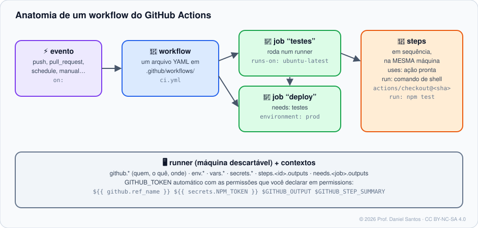

# Módulo 07 · GitHub Actions: fundamentos

> **Você vai sair daqui sabendo:** o que é CI/CD e por que ele muda a vida de um time, como um workflow é montado (eventos, jobs, steps, runners), escrever expressões com contextos, passar dados entre steps e jobs, deixar resumos bonitos na execução, disparar workflows manualmente e por agenda — e depurar quando dá errado, validando tudo localmente com **actionlint** e **act**.

⏱ 5–6 h · 🧪 [Laboratório (act)](../../laboratorio/#opção-d--rodando-workflows-localmente-com-act) · ✍️ [Exercícios](exercicios/)

---

## 1. Cenário

Toda vez que alguém abre um PR na loja, uma pessoa precisa baixar a branch, instalar dependências e rodar os testes. Às vezes esquece. Às vezes roda na máquina dela, que “funciona”. **Integração contínua (CI)** é tirar isso das mãos humanas: a cada push ou PR, uma máquina limpa baixa o código e roda os mesmos passos, sempre — e o resultado aparece no PR (✔ ou ✘). **Entrega contínua (CD)** é o passo seguinte: o que passou é publicado automaticamente.

O **GitHub Actions** é o motor de automação do GitHub: CI/CD e muito mais (rotular issues, gerar releases, publicar sites).

## 2. As peças



| Peça | O que é |
|---|---|
| **Workflow** | um arquivo YAML em `.github/workflows/` (o nome do arquivo é livre) |
| **Evento** (`on:`) | o que dispara: `push`, `pull_request`, `schedule`, `workflow_dispatch`, `release`, `issues`… |
| **Job** | um conjunto de steps que roda **numa máquina** (runner). Jobs rodam **em paralelo**, salvo `needs:` |
| **Step** | um comando (`run:`) ou uma **ação** pronta (`uses:`). Steps de um job rodam em sequência, na mesma máquina, compartilhando arquivos |
| **Runner** | a máquina: hospedada pelo GitHub (`ubuntu-latest`, `windows-latest`, `macos-latest`, `ubuntu-24.04-arm`) ou sua (self-hosted) |
| **Ação** (`uses:`) | um pedaço reutilizável publicado num repositório: `actions/checkout`, `actions/setup-node`… |

## 3. O primeiro workflow, linha a linha

```yaml
name: CI                                   # nome na aba Actions
on:
  push:
    branches: [main]                       # push na main
  pull_request:                            # qualquer PR
permissions:
  contents: read                           # o token automático só LÊ o código (Módulo 10)
jobs:
  testes:                                  # id do job (aparece como nome do check no PR)
    runs-on: ubuntu-latest
    timeout-minutes: 10                    # padrão é 360! limite sempre
    steps:
      - uses: actions/checkout@3d3c42e5aac5ba805825da76410c181273ba90b1 # v7.0.1
        with:
          persist-credentials: false
      - name: Rodar os testes
        run: ./testes.sh
```

> 🔐 **Por que aquele número enorme no lugar de `@v7`?** Uma tag pode ser movida por quem controla o repositório da ação — inclusive um invasor. O **SHA** do commit não muda nunca. O comentário `# v7.0.1` mantém a legibilidade e o Dependabot atualiza os dois juntos. A história completa está no Módulo 10.

## 4. Eventos que você vai usar

```yaml
on:
  push:
    branches: [main, 'release/**']
    paths: ['src/**', '!src/**/*.md']      # só quando código muda
    tags: ['v*']
  pull_request:
    types: [opened, synchronize, reopened]
  workflow_dispatch:                       # botão "Run workflow" (e gh workflow run)
    inputs:
      ambiente:
        type: choice
        options: [homologacao, producao]
  schedule:
    - cron: '0 11 * * 1'                   # toda segunda, 11:00 **UTC** (08:00 em Brasília)
  release:
    types: [published]
```

> ⏰ **`cron` é sempre UTC** e não é pontual: em horários de pico pode atrasar. Em repositórios públicos sem atividade por 60 dias, workflows agendados são desligados automaticamente.

## 5. Contextos e expressões

Tudo entre `${{ }}` é avaliado **pelo GitHub antes** de o step rodar.

| Contexto | Exemplos |
|---|---|
| `github` | `github.ref_name` (branch/tag), `github.sha`, `github.actor`, `github.event_name`, `github.repository`, `github.event.*` (o payload do evento) |
| `env` / `vars` / `secrets` | variáveis do workflow / variáveis de configuração do repositório / segredos |
| `inputs` | entradas do `workflow_dispatch` (e de workflows reutilizáveis) |
| `steps.<id>.outputs` | saídas de um step anterior do mesmo job |
| `needs.<job>.outputs` | saídas de um job anterior |
| `matrix`, `runner`, `job` | Módulo 08 |

```yaml
if: github.event_name == 'push' && github.ref_name == 'main'
if: contains(github.event.pull_request.labels.*.name, 'deploy')
if: failure()                 # só se algo antes falhou (também: success(), always(), cancelled())
run: echo "${{ format('Olá, {0}!', github.actor) }}"
```

| `env` | `vars` | `secrets` |
|---|---|---|
| definido no YAML | definido em *Settings → Secrets and variables → Variables* | definido em *… → Secrets* |
| visível no código | visível nos logs | **mascarado** nos logs (`***`), nunca exibido de volta |
| `env.NOME` / `$NOME` | `vars.NOME` | `secrets.NOME` |

> ⚠️ **Regra de ouro de segurança:** nunca coloque `${{ ... }}` com dados que outra pessoa controla (título de issue, nome de branch, corpo de PR) **dentro de `run:`** — o texto é colado no script *antes* de rodar e vira código. Passe por `env:` e use `"$VARIAVEL"`. O exemplo 01 do Módulo 10 mostra o ataque acontecendo.

## 6. Conversando com o runner: arquivos especiais

| Arquivo (variável) | Para quê | Exemplo |
|---|---|---|
| `$GITHUB_OUTPUT` | saída do step (`steps.ID.outputs.CHAVE`) | `echo "versao=1.2.0" >> "$GITHUB_OUTPUT"` |
| `$GITHUB_ENV` | variável para os **próximos** steps | `echo "AMBIENTE=prod" >> "$GITHUB_ENV"` |
| `$GITHUB_PATH` | pasta adicionada ao PATH dos próximos steps | `echo "$HOME/bin" >> "$GITHUB_PATH"` |
| `$GITHUB_STEP_SUMMARY` | Markdown exibido na página da execução | `echo "### ✅ 42 testes" >> "$GITHUB_STEP_SUMMARY"` |

E **comandos de workflow** pela saída padrão:

```bash
echo "::error file=app.js,line=12::variável não definida"   # anotação vermelha no arquivo, no PR
echo "::warning::versão antiga do Node"
echo "::group::Instalando dependências"; npm ci; echo "::endgroup::"   # seção recolhível no log
echo "::add-mask::$TOKEN_DERIVADO"                            # passa a esconder esse valor nos logs
```

## 7. Acompanhando pelo terminal

```bash
gh workflow list                          # workflows do repositório
gh workflow run relatorio.yml -f dias=3   # dispara um workflow_dispatch
gh run list --workflow ci.yml --limit 5   # últimas execuções
gh run watch                              # acompanha a execução em andamento
gh run view 9000 --log-failed             # só o log dos steps que falharam
gh run rerun 9000 --failed                # roda de novo só os jobs que falharam
gh run download 9000 -n relatorio         # baixa um artefato
```

## 8. Validando antes do push

- **actionlint** — pega erros de sintaxe, expressões inválidas, contextos inexistentes, `needs` para job que não existe e passa o ShellCheck nos `run:`. `actionlint .github/workflows/*.yml`
- **act** — executa o workflow em containers na sua máquina (veja o [laboratório](../../laboratorio/#opção-d--rodando-workflows-localmente-com-act)).
- **Uma pegadinha do YAML:** `on` é palavra reservada do YAML 1.1 (vira `true`). O GitHub entende certo, mas ferramentas genéricas não — o conversor do curso ([`yaml2json.py`](../../ferramentas/lib/yaml2json.py)) corrige isso, e o exemplo 01 mostra o problema.

## 9. Quanto custa

Repositórios **públicos**: minutos ilimitados nos runners padrão. **Privados**: cota mensal por plano (2.000 min no Free), e minutos de Windows e macOS contam multiplicados. Runners self-hosted não consomem cota (mas a máquina é sua — e **nunca** use self-hosted em repositório público: qualquer PR poderia rodar código nela).

## 10. Armadilhas comuns

- **Sem `timeout-minutes`**: um teste travado consome até 6 horas de cota.
- **Workflow que não dispara**: arquivo fora de `.github/workflows/`, extensão `.yaml` com erro de indentação, ou `paths:` que exclui o que mudou.
- **`schedule` em fork** ou em branch que não é a padrão: agendamentos só rodam na branch padrão.
- **Segredo em `if:`** não funciona (segredos não estão disponíveis em `if` de job) — passe por `env` e teste no step.
- **Depender de ordem entre jobs** sem `needs:` — eles rodam em paralelo.
- **`: ` dentro de um `run:` de uma linha** (`run: echo "Total: 3"`) quebra o YAML (*mapping values are not allowed*). Use o bloco `run: |` — o actionlint avisa.

## 📚 Fontes oficiais

- Entendendo o GitHub Actions: <https://docs.github.com/pt/actions/get-started/understand-github-actions>
- Criar um workflow de exemplo: <https://docs.github.com/pt/actions/tutorials/create-an-example-workflow>
- Sintaxe de workflow: <https://docs.github.com/pt/actions/reference/workflows-and-actions/workflow-syntax>
- Eventos que disparam workflows: <https://docs.github.com/pt/actions/reference/workflows-and-actions/events-that-trigger-workflows>
- Contextos: <https://docs.github.com/pt/actions/reference/workflows-and-actions/contexts>
- Expressões: <https://docs.github.com/pt/actions/reference/workflows-and-actions/expressions>
- Comandos de workflow: <https://docs.github.com/pt/actions/reference/workflows-and-actions/workflow-commands>
- Cobrança do Actions: <https://docs.github.com/pt/billing/concepts/product-billing/github-actions>
- actionlint: <https://github.com/rhysd/actionlint> · act: <https://github.com/nektos/act>

---

<sub>© 2026 Prof. Daniel Santos · Curso de GitHub · conteúdo sob CC BY-NC-SA 4.0 · <a href="../../NOTICE.md">aviso de direitos</a></sub>
