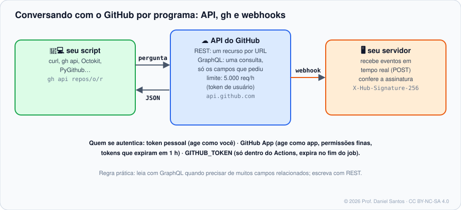

# Módulo 11 · Automação com gh e API

> **Você vai sair daqui sabendo:** falar com o GitHub por programa — **REST** e **GraphQL** pelo `gh api`, paginação, limites de requisição e boas práticas —, escolher entre token pessoal e **GitHub App**, receber eventos em tempo real por **webhooks** (e verificar a assinatura deles) e criar **extensões do `gh`** para os comandos que o seu time repete.

⏱ 4–5 h · 🧪 [Laboratório](../../laboratorio/) · ✍️ [Exercícios](exercicios/)

---

## 1. Cenário

Toda segunda, alguém do time abre 14 repositórios para contar PRs abertos, conferir quem é admin e listar issues sem dono. Tudo isso já está a **uma chamada de API** de distância. Os módulos anteriores usaram o `gh` para tarefas pontuais; aqui você aprende o modelo por baixo dele — e passa a automatizar qualquer coisa que a interface faz.



## 2. REST: um recurso por URL

```bash
gh api repos/aluno/loja                                   # GET é o padrão
gh api repos/aluno/loja/issues -f title="Bug" -f body="…" # -f = campo texto → vira POST
gh api -X PATCH repos/aluno/loja -F has_wiki=false        # -F = campo tipado (true/false/números/@arquivo)
gh api -X DELETE repos/aluno/loja/labels/antigo
gh api repos/aluno/loja/issues --jq '.[].title'           # filtra a resposta
gh api -i repos/aluno/loja                                # mostra os cabeçalhos HTTP
gh api 'repos/{owner}/{repo}/pulls'                       # {owner}/{repo} = o repositório da pasta atual
```

| Opção | Para quê |
|---|---|
| `-X MÉTODO` | GET, POST, PATCH, PUT, DELETE |
| `-f chave=valor` / `-F chave=valor` | campos texto / tipados (`-F arquivo=@dados.json`) |
| `--input arquivo.json` (ou `-` para stdin) | corpo inteiro em JSON (Módulo 06: rulesets) |
| `-H 'Cabeçalho: valor'` | por ex. `X-GitHub-Api-Version` para fixar a versão da API |
| `--paginate` (+ `--slurp`) | segue as páginas automaticamente (e junta tudo num único array) |
| `--jq` / `--template` | filtra / formata a saída |
| `--cache 1h` | reaproveita respostas — economiza limite |

### Paginação

Listas vêm em **páginas** (padrão 30 itens, máximo 100 com `per_page=100`). O cabeçalho `Link` aponta a próxima. **Esquecer a paginação é o bug mais comum de quem automatiza GitHub**: “o script diz que temos 30 repositórios” (temos 312).

```bash
gh api --paginate 'orgs/minha-org/repos?per_page=100' --jq '.[].full_name'          # um nome por linha
gh api --paginate --slurp 'orgs/minha-org/repos?per_page=100' | jq 'add | length'   # total
```

### Limites

| Quem chama | Limite típico |
|---|---|
| sem autenticação | 60 req/h por IP |
| token de usuário | 5.000 req/h |
| `GITHUB_TOKEN` no Actions | 1.000 req/h por repositório |
| busca (`/search`) | 30 req/min |

Há também limites **secundários** (rajadas, muitas escritas seguidas). Respeite `Retry-After`, prefira `--paginate` com `per_page=100` a muitas chamadas pequenas e consulte `gh api rate_limit`.

## 3. GraphQL: uma pergunta, só os campos que você quer

```bash
gh api graphql -F dono=aluno -F nome=loja -f query='
  query($dono: String!, $nome: String!) {
    repository(owner: $dono, name: $nome) {
      issues(states: OPEN) { totalCount }
      pullRequests(states: OPEN, first: 5) { nodes { number title author { login } } }
    }
  }' --jq '.data.repository'
```

| | REST | GraphQL |
|---|---|---|
| Forma | muitos endereços, resposta fixa | um endereço, a consulta define a resposta |
| Bom para | escrever (criar, editar, apagar); casos simples | ler muitos dados relacionados numa ida só |
| Paginação | `page`/`Link` | cursores (`first`, `after`, `pageInfo`) |
| Projects (novos) | — | **só GraphQL** |

## 4. Quem está chamando: tokens e GitHub Apps

| Identidade | Age como | Quando usar |
|---|---|---|
| **Token fine-grained** (Módulo 01) | você, nos repositórios escolhidos | scripts pessoais, automações pequenas |
| **`GITHUB_TOKEN`** | o workflow, só naquele repositório, até o fim do job | quase tudo dentro do Actions |
| **GitHub App** | o **app** (não uma pessoa), com permissões finas por instalação; tokens de 1 hora | integrações de time/empresa, bots, automações que não podem depender de uma pessoa |

> 🧠 **Por que não usar o token do “usuário-robô”?** Contas de máquina compartilhadas acabam com senha anotada em algum lugar, acesso amplo demais e ninguém sabe quem fez o quê. Um GitHub App tem dono, permissões declaradas, tokens curtos e aparece como `app/nome[bot]` no histórico.

## 5. Webhooks: o GitHub chama você

Em vez de perguntar “tem algo novo?” a cada minuto (*polling*), você registra uma URL e o GitHub faz um **POST** a cada evento (`push`, `issues`, `pull_request`, `release`…).

```bash
gh api repos/aluno/loja/hooks -f name=web -F active=true \
  -f 'config[url]=https://loja.exemplo.dev/webhook' -f 'config[content_type]=json' \
  -f 'config[secret]=UM_SEGREDO_LONGO' -f 'events[]=issues' -f 'events[]=pull_request'
```

**Verifique a assinatura sempre.** Qualquer um pode fazer POST na sua URL. O GitHub assina o corpo com o segredo combinado (HMAC-SHA256) e envia no cabeçalho `X-Hub-Signature-256: sha256=<hex>`. Seu servidor recalcula e compara — de preferência em **tempo constante** (`hmac.compare_digest` em Python, `crypto.timingSafeEqual` em Node).

```bash
printf '%s' "$CORPO" | openssl dgst -sha256 -hmac "$SEGREDO" | sed 's/^.* /sha256=/'
```

Mais: o evento `ping` chega ao criar o webhook; entregas ficam em *Settings → Webhooks → Recent Deliveries* (com botão de reenviar); para testar localmente, use um túnel ou `gh webhook forward` (extensão).

## 6. Estendendo o `gh`

Uma **extensão** é só um repositório chamado `gh-NOME` com um executável `gh-NOME`. Qualquer script vira subcomando:

```bash
gh extension create resumo            # cria o esqueleto gh-resumo/
gh extension install .                # instala a partir da pasta atual (para testar)
gh resumo aluno/loja                  # roda!
gh extension install dono/gh-algo     # instala de outro repositório
gh extension list / upgrade --all / remove resumo
```

Extensões úteis da comunidade: `github/gh-actions-lock` (Módulo 10), `dlvhdr/gh-dash` (painel no terminal), `yusukebe/gh-markdown-preview`. Instale extensão como instala dependência: de quem você confia, numa versão fixa (`--pin`).

## 7. Armadilhas comuns

- **Sem paginação** → relatórios silenciosamente errados.
- **Montar JSON com concatenação de strings** (`'{"title":"'$T'"}'`) → quebra com aspas no título. Use `-f`, `--input` com `jq -n --arg`.
- **Comparar assinatura com `==` em servidor exposto** → *timing attack*. Use comparação em tempo constante.
- **Token no código do script** ou em `curl -H "Authorization: …"` registrado no histórico do shell. O `gh` já autentica; no Actions, `GH_TOKEN: ${{ github.token }}`.
- **Martelar a API** num laço sem pausa → limite secundário e bloqueio temporário.

## 📚 Fontes oficiais

- Começando com a API REST: <https://docs.github.com/pt/rest/using-the-rest-api/getting-started-with-the-rest-api>
- Paginação: <https://docs.github.com/pt/rest/using-the-rest-api/using-pagination-in-the-rest-api>
- Limites de requisição: <https://docs.github.com/pt/rest/using-the-rest-api/rate-limits-for-the-rest-api>
- Boas práticas da API REST: <https://docs.github.com/pt/rest/using-the-rest-api/best-practices-for-using-the-rest-api>
- GraphQL: <https://docs.github.com/pt/graphql/overview/about-the-graphql-api>
- Sobre GitHub Apps: <https://docs.github.com/pt/apps/creating-github-apps/about-creating-github-apps/about-creating-github-apps>
- Webhooks e validação de entregas: <https://docs.github.com/pt/webhooks/using-webhooks/validating-webhook-deliveries>
- Criar extensões do gh: <https://docs.github.com/pt/github-cli/github-cli/creating-github-cli-extensions>
- `gh api`: <https://cli.github.com/manual/gh_api>

---

<sub>© 2026 Prof. Daniel Santos · Curso de GitHub · conteúdo sob CC BY-NC-SA 4.0 · <a href="../../NOTICE.md">aviso de direitos</a></sub>
